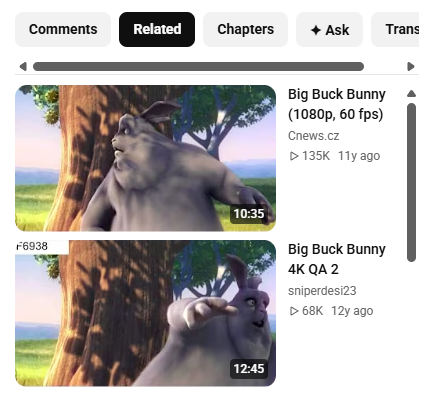
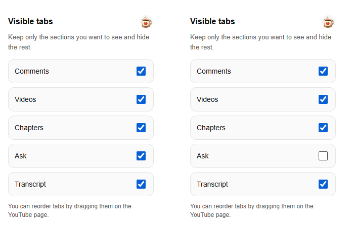
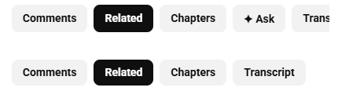
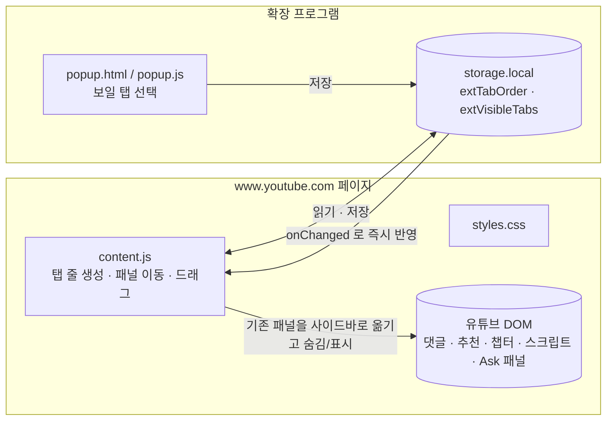

# YouTube Trinity

> PC 유튜브 오른쪽 사이드바에 **추천 영상 · 댓글 · 챕터 · 질문하기 · 스크립트**를 탭으로 모아, 영상을 계속 보면서 확인하게 해 주는 브라우저 확장 프로그램입니다. **Chrome**과 **Firefox** 두 버전의 소스를 함께 담았습니다.

*(English)* A browser extension that gathers YouTube's recommended videos, comments, chapters, Ask and transcript into tabs in the right sidebar, so you can read them without scrolling away from the video. Chrome (Manifest V3) and Firefox builds are included. No build step, no dependencies, no network requests of its own.

[](https://chromewebstore.google.com/detail/youtube-trinity/bhlbodgbbcaecfncjennphkambbkakej)


## 왜 만들었나

PC에서 유튜브를 보면 이런 일이 자꾸 생깁니다.

- 💬 댓글을 보려고 스크롤을 내리면 영상이 화면에서 사라진다
- 🔖 챕터를 확인하려고 플레이어와 오른쪽 목록을 번갈아 본다
- 📝 스크립트를 열려면 설명란의 "더보기"를 누르고 한참 내려가야 한다

YouTube Trinity는 이 정보들을 **오른쪽 사이드바의 탭**으로 모아 한 화면에서 오가게 합니다.

## 기능

- **추천 영상 (Videos / Related)** — 기존 추천 목록을 그대로 두고 독립된 스크롤로 탐색
- **댓글 (Comments)** — 영상을 보면서 댓글을 읽고 쓸 수 있음
- **챕터 (Chapters)** — 챕터 목록을 바로 보고 원하는 구간으로 이동
- **질문하기 (Ask)** — 유튜브가 제공하는 영상에서 "질문하기" 패널을 사이드바에서 사용
- **스크립트 (Transcript)** — 설명란을 뒤지지 않고 텍스트를 훑고, 줄을 누르면 그 시점으로 이동

- **탭 순서 바꾸기** — 탭을 드래그하면 다른 탭이 부드럽게 비켜 서고, 순서는 저장됩니다.
- **보일 탭 고르기** — 확장 프로그램 아이콘을 누르면 나오는 설정에서 필요한 탭만 남기고 숨깁니다. (최소 1개는 남음)
- **6개 언어** — 한국어, English, 日本語, 简体中文, Русский, Deutsch. 탭 이름은 유튜브 화면의 원문을 우선 쓰고, 읽지 못했을 때만 내장 번역을 씁니다(추천 영상 탭만 항상 내장 번역).



**설정 팝업** — 왼쪽: 전체 표시, 오른쪽: Ask를 끈 모습



**사이드바 탭 줄** — 위: 전체 표시, 아래: Ask 숨김



## 설치

### 스토어에서

- **Chrome**: [Chrome 웹 스토어](https://chromewebstore.google.com/detail/youtube-trinity/bhlbodgbbcaecfncjennphkambbkakej)
- **Firefox**: Firefox Add-ons에서 "YouTube Trinity"를 검색하세요. (Firefox 142 이상)

### 소스에서 직접 (개발자용)

빌드가 없으므로 폴더를 그대로 불러오면 됩니다.

```bash
git clone https://github.com/tlanfk/youtube-trinity.git
```

**Chrome / Edge** — `chrome://extensions` → 오른쪽 위 **개발자 모드** 켜기 → **압축해제된 확장 프로그램을 로드합니다** → 저장소의 `chrome/` 폴더 선택

**Firefox** — 주소창에 `about:debugging#/runtime/this-firefox` → **임시 부가 기능 로드...** → 저장소의 `firefox/manifest.json` 선택 (재시작하면 사라지는 임시 설치입니다)

그다음 <https://www.youtube.com> 에서 영상을 열면 사이드바에 탭이 나타납니다.

## 동작 방식과 구조

**빌드도 의존성도 없는** 순수 JavaScript 확장입니다. 서버·계정·네트워크 요청이 없습니다.



- **content script** (`content.js`) 가 `www.youtube.com` 에서만 실행됩니다. 유튜브가 이미 만든 댓글·챕터·스크립트·Ask 패널을 새로 만들지 않고 **사이드바로 옮기고 보이거나 숨기는 방식**이라 유튜브 기능이 그대로 동작합니다.
- 유튜브는 SPA라 페이지 이동 때 새로고침이 없으므로 짧은 주기(700ms)로 상태를 확인하고(주소 변경 감지, 패널 준비 대기), 아직 안 열린 챕터·Ask 패널은 유튜브의 원래 버튼을 대신 눌러 열어 줍니다. 쇼츠 페이지에서는 정리하고 물러납니다.
- **설정**은 `storage.local` 에 두 값만 저장합니다: 탭 순서(`extTabOrder`), 보일 탭(`extVisibleTabs`). 팝업에서 바꾸면 `storage.onChanged` 로 열려 있는 유튜브 탭에 바로 반영됩니다.
- **권한**: `storage` 하나와 `*://www.youtube.com/*` 에서의 content script 뿐입니다.

### 폴더 구조

```text
youtube-trinity/
├─ chrome/                    Chrome / Edge 용 (Manifest V3)
│  ├─ manifest.json
│  ├─ content.js              사이드바 탭 · 패널 이동 · 드래그 정렬 · 다국어 문구
│  ├─ styles.css              사이드바·탭 스타일
│  ├─ popup.html / .css / .js 설정 팝업(보일 탭 선택, 후원 버튼)
│  ├─ icon.png, support-coffee.png
│  └─ _locales/               de en ja ko ru zh_CN  (이름·설명·팝업 문구)
├─ firefox/                   Firefox 용 (같은 구조)
│  └─ + icon-16.png, icon-48.png
└─ docs/screenshots/          README 화면 캡처
```

### Chrome 판과 Firefox 판의 차이

기능은 같아야 하므로 한쪽을 고치면 다른 쪽도 같이 고칩니다. 의도된 차이는 아래뿐입니다.

- `content.js`, `popup.js` — Firefox 판은 `browser`(없으면 `chrome`)를 쓰는 호환 레이어(`extensionApi`)와 Promise 형 `storage.get` 처리가 있고, DOM 삽입에 `innerHTML` 대신 DOM API를 씁니다. Chrome 판은 `chrome.*` 를 직접 씁니다.
- `manifest.json` — Firefox 판에만 `browser_specific_settings.gecko`(부가 기능 id, `data_collection_permissions: none`, `strict_min_version: 142.0`)가 있고 아이콘이 `icon-16/48/128` 로 나뉩니다.
- 나머지 — `styles.css`, `popup.css`, `popup.html`, `_locales/`, 이미지는 두 폴더가 동일합니다.

> **내 Firefox 부가 기능으로 서명·배포하려면** `firefox/manifest.json` 의 `gecko.id` 를 본인 것으로 바꾸세요. 저장소의 값(`youtube-trinity@doolli.local`)은 이미 게시된 부가 기능의 식별자라 바꾸면 업데이트가 이어지지 않아 그대로 두었습니다.

## 개인정보

- 수집·전송하는 데이터가 **없습니다.** 시청 기록, 계정 정보, 입력한 내용을 저장하거나 외부로 보내지 않습니다.
- 저장하는 것은 탭 순서와 보일 탭 같은 **화면 설정값** 뿐이며 브라우저(로컬)에만 남습니다.
- 원격 코드를 내려받아 실행하지 않습니다.

## 알아둘 점

- **유튜브 화면 구조에 의존합니다.** 유튜브가 DOM을 바꾸면 일부 탭이 동작하지 않을 수 있어, 그때마다 `content.js` 를 고쳐야 합니다. 이슈로 알려 주세요.
- **검증 범위** (2026-10-20): Chromium(Playwright 번들)에 `chrome/` 과 `firefox/` 폴더를 각각 불러 YouTube 영상에서 탭 5개 표시, 탭 전환, 설정 팝업에서 Ask 숨김이 사이드바에 즉시 반영되는 것까지 확인했습니다. Firefox 판은 실제 Firefox에서 이 시점에 다시 시험하지는 않았습니다(이미 Firefox Add-ons에 게시된 버전과 같은 소스입니다). 자동 테스트 코드는 없습니다.
- 팝업의 커피 아이콘은 작성자의 후원 페이지로 연결됩니다. 포크해서 쓰면 `popup.js` 맨 위의 `SUPPORT_COFFEE_URL` 을 바꾸거나, `popup.html` 의 해당 버튼을 지우세요.
- YouTube는 Google LLC의 상표이며, 이 프로젝트는 YouTube·Google과 관련이 없습니다.

## 버그 제보 · 기여

[Issues](https://github.com/tlanfk/youtube-trinity/issues)에 남겨 주세요. 화면이 깨지면 **영상 주소와 브라우저 종류·버전**을 같이 알려 주시면 재현이 쉽습니다.

## 라이선스

[MIT](LICENSE)
